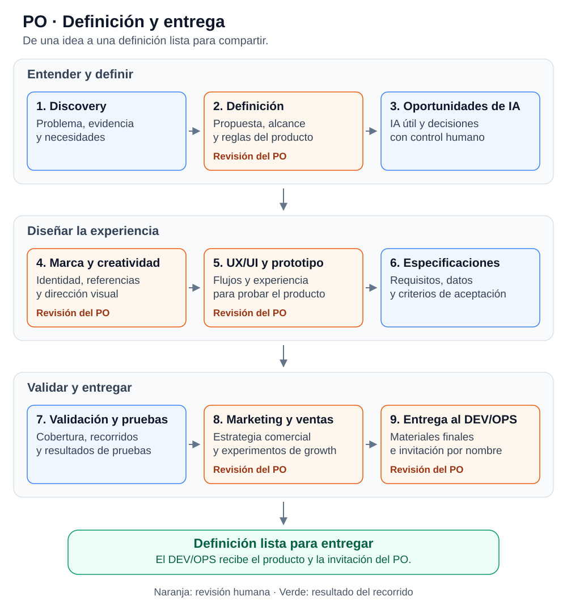
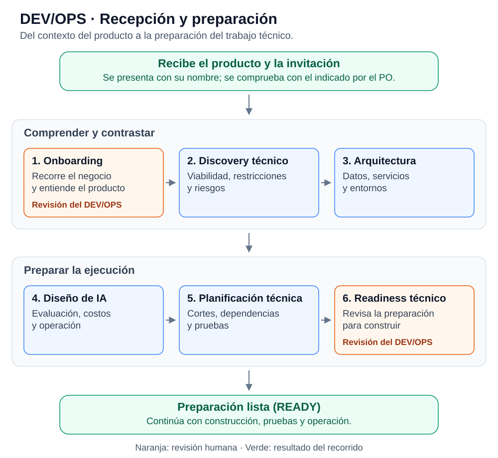

# Closelly AI-PLC Workflows

[](https://github.com/Closelly/aiplc-workflows/actions/workflows/ci.yml)
[Licencia MIT](LICENSE) · [Inicio rápido](docs/getting-started.md) · [Contribuir](CONTRIBUTING.md)

Closelly AI-PLC es un proyecto independiente inspirado en
[AWS AI-DLC Workflows](https://github.com/awslabs/aidlc-workflows). Su propósito es
**simplificar el proceso de llevar una idea a un producto definido y preparado
para su construcción y operación**, mediante la colaboración entre dos actores humanos:

- **PO — Product Owner:** entiende al cliente y el problema, define el producto y
  su propuesta de valor, toma las decisiones de negocio y revisa las entregas.
- **DEV/OPS — Desarrollo y Operaciones:** recibe la definición del producto,
  contrasta su viabilidad técnica y prepara la arquitectura y el plan para
  construirlo y operarlo.

La IA acompaña a ambos: investiga, propone, redacta y organiza la evidencia.
Las decisiones y aprobaciones corresponden a las personas responsables. El PO
entrega una definición trazable y el DEV/OPS continúa desde ese contexto compartido.

La CLI `closelly-aiplc` conserva el estado, comprueba los entregables y controla
las transiciones y el sello Git. ChatGPT/Codex guía el trabajo por conversación.
En los comandos de la herramienta, el rol DEV/OPS se identifica como `dev`.

## Empieza aquí

**Estado: versión 0.2.0.** Consulta los paquetes y notas en
[Releases](https://github.com/Closelly/aiplc-workflows/releases).

**[Abrir Codex para instalar Closelly AI-PLC](https://closelly.github.io/aiplc-workflows/?open=1)**

El enlace abre una solicitud de instalación preparada en la aplicación de escritorio.
Revísala y envíala en Codex para comenzar. Si el navegador no abre la aplicación,
la página también permite copiar la solicitud y pegarla en el chat que ya tienes abierto.

También puedes instalar directamente en una terminal de macOS, Linux o WSL:

```sh
curl -fsSL https://github.com/Closelly/aiplc-workflows/releases/latest/download/install.sh | sh
```

El instalador detecta tu equipo, descarga el ejecutable nativo, verifica su SHA-256,
instala la metodología y las skills de Codex, configura el PATH y ejecuta el
comprobador básico. **No necesitas clonar el código ni instalar Bun o Node.js para
empezar.** Se requiere Git; si falta, el instalador explica cómo continuar.
No usa sudo. Abre una terminal nueva al terminar y comprueba:

```sh
closelly-aiplc doctor --core
```

| Quieres… | Continúa en… |
| --- | --- |
| Crear tu primer producto y trabajar por chat | [Guía de inicio](docs/getting-started.md) |
| Elegir versión, actualizar o desinstalar | [Instalación](docs/installation.md) |
| Contribuir o compilar desde el código | [Contribuir](CONTRIBUTING.md) |
| Preparar una release pública | [Publicación](docs/releasing.md) |
| Entender estados, participantes y recuperación | [Arquitectura](docs/architecture.md) |

Al integrar en `main` una versión nueva en `package.json`, GitHub ejecuta las
pruebas, construye los paquetes y crea el borrador de la release. La publicación
final se realiza manualmente desde Releases.

## El recorrido de las personas

1. **El PO se presenta:** “Me llamo Luis y quiero trabajar esta idea”. Con su nombre
   basta para empezar. Codex le ayuda a entender el problema y definir el producto.
2. **El PO decide a quién entregar:** al terminar, indica “Ana será quien continúe
   el desarrollo”. La herramienta prepara una invitación para Ana junto con la entrega.
3. **El DEV/OPS se presenta:** Ana abre el producto recibido y dice “Me llamo Ana”.
   La herramienta comprueba que su nombre coincide con el que indicó el PO.
4. **El DEV/OPS continúa:** recorre el negocio y el producto, resuelve dudas y prepara
   la construcción y la operación con ayuda de Codex.

Las revisiones importantes se confirman por la persona responsable y quedan
registradas con su nombre, fecha y documentos revisados. No necesitas elegir al
DEV/OPS para empezar Discovery.

## Cómo se usa desde el chat

1. Instala la herramienta una vez en tu computador.
2. Abre en Codex la carpeta donde quieres trabajar y pide: **“Usa
   `$closelly-aiplc-po` para crear mi producto. Guíame paso a paso y detente antes de
   cualquier aprobación.”** El asistente acuerda el nombre, una carpeta nueva y
   tu nombre antes de crear el producto. El destinatario DEV/OPS se elige al final.
3. Conversa sobre tu cliente y el problema. El asistente investiga, hace preguntas
   y prepara documentos; la CLI conserva y verifica el estado real.
4. Para retomar, abre la carpeta del producto y pide que continúe desde el estado
   actual. `po resume` entrega el encargo; el asistente realiza el trabajo.

El recorrido integrado requiere acceso a la carpeta y a una terminal. En un chat de
ChatGPT sin ese acceso, se pueden discutir propuestas, pero hay que trasladar los
archivos y ejecutar los comandos localmente. Este repositorio distribuye una CLI y
skills locales; todavía no incluye un plugin instalable de ChatGPT.

La instalación básica permite empezar Discovery. La producción del video de
handoff requiere herramientas adicionales: [configuración multimedia](docs/video.md).

## Iniciar un producto

Para empezar, el PO solo indica su nombre, el nombre del producto y una idea.
En Codex puede pedirlo por conversación; estos son los comandos equivalentes:

```sh
closelly-aiplc po init /ruta/producto-nuevo \
  --po-name "Luis" --name "Taller de pedidos" \
  --idea "Organizar la recepción y seguimiento de encargos"
cd /ruta/producto-nuevo
closelly-aiplc po start
closelly-aiplc po resume
```

La carpeta destino debe ser nueva. Codex puede ayudarte a elegirla. El correo es
opcional; no se piden claves ni datos del DEV/OPS al comenzar.

`po init` ejecuta `git init`. En la raíz crea solo `AGENTS.md`, `docs/` y el directorio
interno `.git/`. La definición y el estado PO quedan en `docs/aiplc/`. Las carpetas
`docs/business/`, `docs/technical/` y `docs/operations/` reflejan el conocimiento vigente.
El estado DEV aparece en `docs/technical/aiplc/state.json` al iniciar su onboarding.

## PO · Definición y entrega

Abre el nuevo producto en Codex e invoca `$closelly-aiplc-po`. Si prefieres otro entorno,
`config --harness portable` y `harness context po --json` exponen el mismo encargo.
El PO revisa los resultados y confirma las aprobaciones en una terminal interactiva.
Al preparar la entrega, indica el nombre de quien continuará como DEV/OPS.



Las etapas en naranja requieren una aprobación humana del PO. La entrega sellada
marca el paso del trabajo de definición al recorrido del DEV/OPS.

| Etapa | Qué preparamos | Revisión del PO |
| --- | --- | --- |
| Discovery | Problema, evidencia, hipótesis y decisiones | |
| Definición | Propuesta, alcance, reglas y resultados | Negocio |
| AI-native | Oportunidades, control humano, evaluación y fallback | |
| Marca y creatividad | Fuentes, capturas, tres rutas, taller y tokens | Creatividad |
| UX/UI | Prototipo, flujos, accesibilidad y evidencia | Experiencia |
| Especificaciones | Requisitos con criterios, datos e integraciones | |
| Validación y pruebas | Cobertura, resultados de prototipo y casos pendientes de implementación | |
| Marketing, ventas y growth | Tres fases, experimentos, presupuesto y tareas del PO | Comercial |
| Handoff | Paquete comercial, presentación, prototipo, película e invitación al DEV/OPS | Handoff |

- `po status` muestra avance y faltantes. `po resume` entrega el encargo a Codex con instrucciones, schemas y salidas.
- `po scaffold` crea borradores Markdown sin sobrescribir trabajo. `po validate` comprueba artefactos. `po advance` cierra la fase activa.
- `po approve --note "Qué revisé y qué decidí"` registra el gate de la fase y la versión exacta de los archivos.
- `po revise ID-FASE --note "Motivo y efecto"` vuelve a la primera fase afectada. Renueva las aprobaciones posteriores y conserva los archivos para revisarlos.

Para preparar la entrega, completa `briefing.json`, `video-plan.json` y el handoff
comercial dentro de `docs/aiplc/09-handoff/`. Sigue la [guía de video](docs/video.md).
Revisa el paquete y deja evidencia en `validation-report.md` antes de confirmar la entrega.

```sh
closelly-aiplc po invite --dev-name "Ana"
closelly-aiplc doctor --probe
closelly-aiplc po handoff --prepare
closelly-aiplc po approve --note "Revisé el prototipo, las presentaciones y el MP4."
closelly-aiplc po handoff
```

El cierre conserva la definición y la invitación en una entrega Git. Comparte el
repositorio y `docs/aiplc/09-handoff/INVITACION-DEV.md` con la persona indicada. El PO
conserva su estrategia, materiales y plan de acción en su handoff comercial.

## DEV/OPS · Recepción y preparación



El DEV/OPS revisa y aprueba su comprensión inicial y la preparación final.
Después de READY, la implementación y la operación siguen el proceso habitual del equipo.

El DEV/OPS abre el producto y la invitación en Codex. Solo debe decir su nombre.
La herramienta comprueba que coincide con el destinatario indicado por el PO y
le presenta el recorrido. El mensaje puede ser tan simple como:

> Me llamo Ana. El PO me invitó a recibir este producto. Usa `$closelly-aiplc-dev`
> y guíame paso a paso.

Los comandos equivalentes son:

```sh
closelly-aiplc dev onboard --name "Ana"
closelly-aiplc dev resume
```

El recorrido presenta negocio, pitch, presentaciones, película, prototipo, estructura,
requisitos y dudas en ese orden. El paso `video-briefing` exige una confirmación
interactiva. Al terminar, redacta `understanding.md`, ejecuta `dev approve` y `dev advance`.
`dev clarify --reference RUTA --note "Pregunta" --blocking` registra una duda que el
PO puede responder con `po answer Q-ID --note "Respuesta"`. Un cambio de alcance va
primero en la documentación vigente de negocio mediante `knowledge update`.

Las fases posteriores son discovery técnico, arquitectura (`dev architect`),
diseño técnico de IA, planificación (`dev plan`) y readiness (`dev ready --note ...`).
Cada fase entrega documentos y verificaciones. A partir de READY el equipo continúa
con su práctica habitual de implementación, pruebas y operación.

## Conocimiento, estados y límites

`knowledge audit` comprueba el sello, el historial de actualizaciones y dudas pendientes.
`knowledge update business|technical|operations RUTA --from ARCHIVO --reference RUTA_ORIGEN --note ...`
registra un cambio y su responsable. Los cambios de negocio los confirma el PO. Añade
`--scope-change` al modificar el alcance. Architecture y Operations deben distinguir
lo planeado de lo que se observa en producción.

Los nombres identifican a los participantes declarados. La invitación permite
comprobar que el DEV/OPS es el destinatario indicado; las aprobaciones se vinculan a
los documentos revisados. El acceso al repositorio se administra con las herramientas
del equipo. Detalles en [arquitectura y recuperación](docs/architecture.md).

Consulta [cómo se probó](docs/verification.md) y `closelly-aiplc help`.

## Comunidad y licencia

Consulta [CONTRIBUTING.md](CONTRIBUTING.md), el [código de conducta](CODE_OF_CONDUCT.md),
la [política de seguridad](SECURITY.md) y el [historial de cambios](CHANGELOG.md).
El código propio se distribuye bajo [MIT](LICENSE); las dependencias conservan
sus licencias en [los avisos de terceros](THIRD_PARTY_NOTICES.md).

Proyecto independiente, sin afiliación ni respaldo de AWS u OpenAI.
